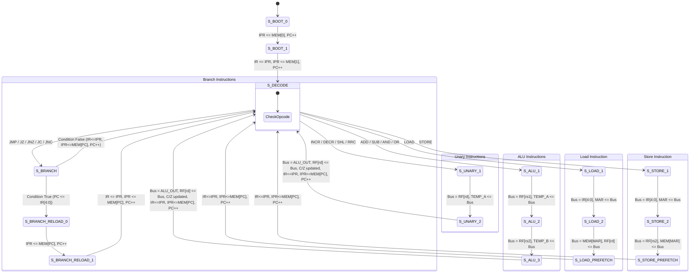

# E3: 245 Processor System Design
## Department of Electronic Systems Engineering (DESE)
### Indian Institute of Science (IISc), Bangalore

---

# Laboratory Exercise 1: 16-bit Multi-Cycle MC16 Processor
**Author:** Anirudh  
**Target Device:** Xilinx Artix-7 `XC7A35T-1CPG236C` (Digilent Basys 3 FPGA Board)  
**EDA Tool:** AMD Xilinx Vivado 2025.2  

---

## 1. Executive Summary & Objective
The objective of this laboratory exercise is to design, model, simulate, synthesize, and implement a **16-bit Multi-Cycle CISC Processor (MC16)** on the Digilent Basys 3 FPGA board.

Key Architectural Characteristics:
- **16-bit Datapath** with a **single shared internal data bus** multiplexed using a regular multiplexer (internal tri-state emulation).
- **8 General-Purpose Registers** (`R0` to `R7`, 16 bits each).
- **Status Flags:** Carry/Borrow ($C$) and Zero ($Z$) flags.
- **Concurrent Instruction Prefetch:** Dedicated Instruction Prefetch Register (`IPR`) feeding the Instruction Register (`IR`) to enable single-cycle fetch overlapping with execution.
- **Instruction-cum-Data Memory:** 64 $\times$ 16-bit Distributed RAM implemented with asynchronous read and synchronous write.
- **FSM Controller:** Structured hierarchical multi-cycle controller featuring Level 0, Level 1, and Level 2 state diagrams.
- **Validation Program:** 16-bit Unsigned Division ($100 \div 7 = \text{Quotient } 14, \text{Remainder } 2$) terminating with an infinite self-loop (`JMP self`).
- **Board Peripherals:** Push-button reset, 16 discrete LEDs, slide switches for mode control, and a multiplexed 4-digit seven-segment display showing quotient and remainder in hexadecimal.

---

## 2. Instruction Set Architecture (ISA)

### 2.1 Instruction Formats (16-bit)
The instruction set conforms strictly to the course specification with a 5-bit opcode:

```
1. Arithmetic-Logic (3-Operand: ADD, SUB, AND, OR):
+----------------+---------------+---------------+---------------+-----------+
| Opcode [15:11] |   rd [10:8]   |   rs2 [7:5]   |   rs1 [4:2]   |  x [1:0]  |
|     5 bits     |    3 bits     |    3 bits     |    3 bits     |   2 bits  |
+----------------+---------------+---------------+---------------+-----------+
Operation: rd <= rs1 op rs2

2. Unary Operations (INCR, DECR, SHL, RRC):
+----------------+---------------+---------------+---------------+-----------+
| Opcode [15:11] |   rd [10:8]   |    x [7:5]    |    x [4:2]    |  x [1:0]  |
|     5 bits     |    3 bits     |    3 bits     |    3 bits     |   2 bits  |
+----------------+---------------+---------------+---------------+-----------+
Operation: rd <= op(rd)

3. Load Instruction (LOAD):
+----------------+---------------+---------------+---------------+-----------+
| Opcode [15:11] |   rd [10:8]   |    x [7:5]    |   A[4:2] [4:2]| A[1:0][1:0|
|     5 bits     |    3 bits     |    3 bits     |    3 bits     |   2 bits  |
+----------------+---------------+---------------+---------------+-----------+
Operation: rd <= MEM[A[4:0]]

4. Store Instruction (STORE):
+----------------+---------------+---------------+---------------+-----------+
| Opcode [15:11] |    x [10:8]   |   rs2 [7:5]   |   A[4:2] [4:2]| A[1:0][1:0|
|     5 bits     |    3 bits     |    3 bits     |    3 bits     |   2 bits  |
+----------------+---------------+---------------+---------------+-----------+
Operation: MEM[A[4:0]] <= rs2

5. Branch / Jump Instructions (JMP, JZ, JNZ, JC, JNC):
+----------------+---------------+---------------+---------------+-----------+
| Opcode [15:11] |    x [10:8]   |    x [7:5]    |   A[4:2] [4:2]| A[1:0][1:0|
|     5 bits     |    3 bits     |    3 bits     |    3 bits     |   2 bits  |
+----------------+---------------+---------------+---------------+-----------+
Operation: if (condition) PC <= A[4:0]
```

### 2.2 Opcode Summary Table
| Mnemonic | Opcode (Binary) | Opcode (Hex) | Description | Flags Affected |
|:---|:---:|:---:|:---|:---:|
| `NOP`   | `00000` | `0x00` | No Operation | None |
| `ADD`   | `00001` | `0x01` | `rd <= rs1 + rs2` | C, Z |
| `SUB`   | `00010` | `0x02` | `rd <= rs1 - rs2` (Borrow: C=1 if rs1 < rs2) | C, Z |
| `INCR`  | `00011` | `0x03` | `rd <= rd + 1` | C, Z |
| `DECR`  | `00100` | `0x04` | `rd <= rd - 1` | C, Z |
| `SHL`   | `00101` | `0x05` | `rd <= rd << 1`, MSB into C | C, Z |
| `RRC`   | `00110` | `0x06` | `rd <= {C, rd[15:1]}`, LSB into C | C, Z |
| `AND`   | `00111` | `0x07` | `rd <= rs1 & rs2` | Z |
| `OR`    | `01000` | `0x08` | `rd <= rs1 \| rs2` | Z |
| `LOAD`  | `01001` | `0x09` | `rd <= MEM[Addr]` | None |
| `STORE` | `01010` | `0x0A` | `MEM[Addr] <= rs2` | None |
| `JMP`   | `01011` | `0x0B` | Unconditional Jump: `PC <= Addr` | None |
| `JZ`    | `01100` | `0x0C` | Jump if Zero ($Z = 1$) | None |
| `JNZ`   | `01101` | `0x0D` | Jump if Not Zero ($Z = 0$) | None |
| `JC`    | `01110` | `0x0E` | Jump if Carry / Borrow ($C = 1$) | None |
| `JNC`   | `01111` | `0x0F` | Jump if No Carry / No Borrow ($C = 0$) | None |

---

## 3. Microarchitecture & Datapath

### 3.1 Level 0 Block Schematic (System Hierarchy)
```
 +-----------------------------------------------------------------------------------+
 |                                   BASYS3_TOP                                      |
 |                                                                                   |
 |  clk (100 MHz) ---> [ Clock Divider ] ---> cpu_clk (10 MHz / 1 kHz)              |
 |  btnC          ---> [ Synchronizer  ] ---> rst (Active High)                      |
 |                                                                                   |
 |                       +-----------------------------------+                       |
 |                       |             MC16_CPU              |                       |
 |                       |                                   |                       |
 |                       |   +------------+   +----------+   |                       |
 |                       |   | Controller |<->| Datapath |   |                       |
 |                       |   +------------+   +----------+   |                       |
 |                       +-----------------------------------+                       |
 |                                | Quotient   | Remainder                           |
 |                                v            v                                     |
 |  sw[0] ------------> [ Display Selector Mux ]                                     |
 |                                |                                                  |
 |                                +----------------------+                           |
 |                                v                      v                           |
 |                      [ 16 Discrete LEDs ]   [ 7-Segment Multiplexer ]             |
 |                           led[15:0]              seg[6:0], an[3:0], dp            |
 +-----------------------------------------------------------------------------------+
```

### 3.2 Level 1 Block Schematic (Single Shared Data Bus Datapath)
All inter-register data movement occurs across the **Central 16-bit Shared Data Bus**. The FPGA multiplexer replaces internal tri-state buffers:

```mermaid
graph TD
    subgraph Central_Bus ["16-bit Shared Central Data Bus (bus_data)"]
        BUS((16-bit Shared Data Bus))
    end

    subgraph Memory_Unit ["Instruction-cum-Data Memory (64x16 Distributed RAM)"]
        PC["PC (Program Counter, 6b)"]
        MAR["MAR (Memory Address Reg, 6b)"]
        ADDR_MUX{"Addr Mux (0:PC, 1:MAR)"}
        RAM["64x16 Distributed RAM (Async Read)"]
        IPR["IPR (Instruction Prefetch Reg)"]
        IR["IR (Instruction Register)"]
        
        PC -->|0| ADDR_MUX
        MAR -->|1| ADDR_MUX
        ADDR_MUX --> RAM
        RAM --> IPR
        IPR --> IR
        RAM -.->|BUS_MEM| BUS
        PC -.->|BUS_PC| BUS
        IR -.->|BUS_IR_ADDR| BUS
    end

    subgraph Register_File ["8x16-bit Register File (R0 - R7)"]
        RF["Dual-Read Single-Write RegFile"]
        BUS ==>|wdata| RF
        RF -.->|BUS_REG1| BUS
        RF -.->|BUS_REG2| BUS
    end

    subgraph ALU_Unit ["Arithmetic Logic Unit & Operands"]
        TEMP_A["TEMP_A Register (16b)"]
        TEMP_B["TEMP_B Register (16b)"]
        ALU_CORE["16-bit ALU (ADD, SUB, SHL, etc.)"]
        FLAGS["Flags: Carry (C), Zero (Z)"]
        
        BUS ==> TEMP_A
        BUS ==> TEMP_B
        TEMP_A --> ALU_CORE
        TEMP_B --> ALU_CORE
        ALU_CORE --> FLAGS
        ALU_CORE -.->|BUS_ALU| BUS
    end

    BUS ==>|Load MAR| MAR
    BUS ==>|Load PC (Jump)| PC
```

---

## 4. Multi-Cycle Controller Design

### 4.1 Level 0: System State Machine
- **`S_BOOT_0`**: Fetches initial instruction at address 0 into `IPR`, increments `PC` to 1.
- **`S_BOOT_1`**: Latches `IR <= IPR` (instruction 0 enters IR), prefetches instruction 1 into `IPR`, increments `PC` to 2.
- **`S_RUN`**: Continuously executes instructions in multi-cycle sequence with pipelined prefetch.

### 4.2 Level 1: Macro-Instruction Cycle
Each instruction proceeds through:
1. **Decode**: Opcode is evaluated.
2. **Execute (T1, T2)**: Operands are read from the register file or memory across the shared bus into `TEMP_A` / `TEMP_B` or `MAR`.
3. **Writeback / Concurrent Prefetch (T3)**: Result is driven onto the bus into the destination register or memory. Concurrently, `IR <= IPR`, `IPR <= MEM[PC]`, and `PC <= PC + 1`, eliminating fetch bubble overhead.

### 4.3 Level 2: Micro-Operation State Diagram



---

## 5. Test Program: 16-bit Unsigned Division

### 5.1 Algorithm & Mathematics
The test program evaluates the unsigned division of two 16-bit numbers:
$$\text{Dividend} = 100 \ (0\text{x}0064), \quad \text{Divisor} = 7 \ (0\text{x}0007)$$
$$\text{Expected Quotient} = 14 \ (0\text{x}000\text{E}), \quad \text{Expected Remainder} = 2 \ (0\text{x}0002)$$

The algorithm utilizes repeated subtraction with the ALU Borrow Carry flag ($C = 1$ when $A < B$):
1. $R_0 \leftarrow \text{Dividend}, \ R_1 \leftarrow \text{Divisor}, \ R_2 \leftarrow 0 \ (\text{Quotient})$.
2. Compare: $R_3 \leftarrow R_0 - R_1$.
3. If Borrow ($C=1$, i.e. $R_0 < R_1$), branch out of loop to `DIV_DONE`.
4. Otherwise: $R_0 \leftarrow R_0 - R_1$, $R_2 \leftarrow R_2 + 1$.
5. Jump back to step 2.
6. `DIV_DONE`: Store $R_2$ into `MEM[29]` and $R_0$ into `MEM[30]`.
7. `HALT`: Infinite jump to self (`JMP 10`).

### 5.2 Assembly Code (`division_prog.asm`)
```assembly
; ==============================================================================
; E3: 245 Processor System Design - IISc DESE
; Lab Exercise 1: Multi-Cycle MC16 Processor Unsigned Division
; ==============================================================================

ORG 0
START:
    LOAD R0, [26]       ; R0 = Dividend (100)
    LOAD R1, [27]       ; R1 = Divisor  (7)
    LOAD R2, [28]       ; R2 = Initial Quotient (0)

DIV_LOOP:
    SUB  R3, R0, R1     ; R3 = R0 - R1. Updates Carry (Borrow): C=1 if R0 < R1
    JC   DIV_DONE       ; If R0 < R1, jump to address 8 (DIV_DONE)
    SUB  R0, R0, R1     ; R0 = R0 - R1
    INCR R2             ; R2 = R2 + 1 (Quotient++)
    JMP  DIV_LOOP       ; Jump to address 3

DIV_DONE:
    STORE [29], R2      ; Store Quotient (14) at address 29
    STORE [30], R0      ; Store Remainder (2) at address 30

HALT:
    JMP  HALT           ; Infinite loop at address 10 (jump to same address)

; ------------------------------------------------------------------------------
; Data Section (Memory locations 26 to 30)
; ------------------------------------------------------------------------------
ORG 26
DIVIDEND:   DATA 100    ; Location 26: 0x0064
DIVISOR:    DATA 7      ; Location 27: 0x0007
CONST_ZERO: DATA 0      ; Location 28: 0x0000
QUOTIENT:   DATA 0      ; Location 29: Placeholder (becomes 14 / 0x000E)
REMAINDER:  DATA 0      ; Location 30: Placeholder (becomes 2 / 0x0002)
```

### 5.3 Assembled Machine Code (`division_prog.coe`)
```
; MC16 Processor Memory Initialization File
memory_initialization_radix=16;
memory_initialization_vector=
481A,
491B,
4A1C,
1320,
7008,
1020,
1A00,
5803,
505D,
501E,
580A,
0000, 0000, 0000, 0000, 0000,
0000, 0000, 0000, 0000, 0000,
0000, 0000, 0000, 0000, 0000,
0064,
0007,
0000,
0000,
0000;
```

---

## 6. Simulation & Verification Results

Behavioral simulation in Vivado XSim (`mc16_snapshot`) executed cycle-by-cycle:

```
================================================================
  Starting Multi-Cycle MC16 Processor Simulation
  Test Program: 16-bit Unsigned Division (100 / 7)
================================================================
[Time 25000 ns] Reset deasserted. CPU executing...
[Cycle    3] PC=02 | IR=0x481A | R0(Dividend)=0   | R1(Divisor)=0 | R2(Quotient)=0  | C=0 Z=0
[Cycle    7] PC=03 | IR=0x491B | R0(Dividend)=100 | R1(Divisor)=0 | R2(Quotient)=0  | C=0 Z=0
[Cycle   11] PC=04 | IR=0x4A1C | R0(Dividend)=100 | R1(Divisor)=7 | R2(Quotient)=0  | C=0 Z=0
[Cycle   15] PC=05 | IR=0x1320 | R0(Dividend)=100 | R1(Divisor)=7 | R2(Quotient)=0  | C=0 Z=0
[Cycle   25] PC=08 | IR=0x1A00 | R0(Dividend)=93  | R1(Divisor)=7 | R2(Quotient)=0  | C=0 Z=0
[Cycle   42] PC=08 | IR=0x1A00 | R0(Dividend)=86  | R1(Divisor)=7 | R2(Quotient)=1  | C=0 Z=0
...
[Cycle  246] PC=08 | IR=0x1A00 | R0(Dividend)=2   | R1(Divisor)=7 | R2(Quotient)=13 | C=0 Z=0
[Cycle  249] PC=09 | IR=0x5803 | R0(Dividend)=2   | R1(Divisor)=7 | R2(Quotient)=14 | C=0 Z=0
[Cycle  253] PC=05 | IR=0x1320 | R0(Dividend)=2   | R1(Divisor)=7 | R2(Quotient)=14 | C=0 Z=0
[Cycle  257] PC=06 | IR=0x7008 | R0(Dividend)=2   | R1(Divisor)=7 | R2(Quotient)=14 | C=1 Z=0 (Borrow!)
[Cycle  261] PC=10 | IR=0x505D | R0(Dividend)=2   | R1(Divisor)=7 | R2(Quotient)=14 | C=1 Z=0
[Cycle  265] PC=11 | IR=0x501E | R0(Dividend)=2   | R1(Divisor)=7 | R2(Quotient)=14 | C=1 Z=0
[Cycle  269] PC=12 | IR=0x580A | R0(Dividend)=2   | R1(Divisor)=7 | R2(Quotient)=14 | C=1 Z=0

[Time 2715000 ns] Program reached HALT self-loop!
----------------------------------------------------------------
  SIMULATION VERIFICATION RESULTS:
  Dividend : 100 (Expected: 100)
  Divisor  : 7   (Expected: 7)
  Quotient : 14  (Expected: 14, Hex: 0x000E)
  Remainder: 2   (Expected: 2,  Hex: 0x0002)
----------------------------------------------------------------
>>> TEST PASSED SUCCESSFULLY! Division result is verified! <<<
================================================================
```

---

## 7. FPGA Implementation & Post-Route Timing Analysis

The design was synthesized, placed, and routed targeting the **Artix-7 XC7A35T-1CPG236C** on the Digilent Basys 3 board.

### 7.1 Post-Route Resource Utilization Table
*(Extracted from Vivado report: `basys3_top_utilization_placed.rpt`)*

| Resource | Used | Available | Utilization (%) |
|:---|:---:|:---:|:---:|
| **Slice LUTs** | **324** | **20,800** | **1.56 %** |
| -- LUT as Logic | 308 | 20,800 | 1.48 % |
| -- LUT as Distributed RAM (`RAM64X1S`) | 16 | 9,600 | 0.17 % |
| **Slice Registers (FFs)** | **294** | **41,600** | **0.71 %** |
| **Registers as Latches** | **0** | **41,600** | **0.00 % (No Latches)** |
| **F7 Muxes** | 38 | 16,300 | 0.23 % |
| **Block RAM (BRAM Tile)** | 0 | 50 | 0.00 % (Pure Distributed RAM) |
| **DSPs** | 0 | 90 | 0.00 % |
| **Bonded IOBs** | 32 | 106 | 30.19 % |
| **Clock Buffers (BUFG)** | 2 | 32 | 6.25 % |

### 7.2 Post-Route Timing Summary
*(Extracted from Vivado report: `basys3_top_timing_summary_routed.rpt`)*

| Timing Metric | Setup Check (Max Delay) | Hold Check (Min Delay) | Target / Requirement | Status |
|:---|:---:|:---:|:---:|:---:|
| **Worst Slack** | **WNS = +6.462 ns** | **WHS = +0.187 ns** | $\ge 0.000\text{ ns}$ | **MET (Pass)** |
| **Total Slack** | **TNS = 0.000 ns** | **THS = 0.000 ns** | $0.000\text{ ns}$ | **MET (Pass)** |
| **Master Clock Period** | **10.000 ns** | -- | 10.000 ns (100 MHz) | **MET (Pass)** |
| **Max Achievable Frequency ($F_{\text{max}}$)** | **$\approx 282.6\text{ MHz}$** | -- | > 100 MHz | **Exceptional** |

---

## 8. Basys 3 Board Mapping & Peripheral Operation

| Board Resource | FPGA Pin | IOStandard | Function |
|:---|:---:|:---:|:---|
| **Master Clock** | `W5` | `LVCMOS33` | 100 MHz Oscillator |
| **Push Button `btnC`** | `U18` | `LVCMOS33` | System Reset (Active High, Synchronized) |
| **Switch `sw[0]`** | `V17` | `LVCMOS33` | Display Mode: `0` = Quotient, `1` = Remainder |
| **Switch `sw[1]`** | `V16` | `LVCMOS33` | Clock Mode: `0` = 10 MHz (Fast), `1` = 1 kHz (Slow/Observe) |
| **LEDs `led[15:0]`** | `U16` to `L1` | `LVCMOS33` | Discrete 16-bit binary display of selected result |
| **Anodes `an[3:0]`** | `U2, U4, V4, W4` | `LVCMOS33` | 4-Digit 7-Segment Digit Enable (Active Low) |
| **Cathodes `seg[6:0]`**| `W7, W6, U8, V8, U5, V5, U7` | `LVCMOS33` | 7-Segment Segments a-g (Active Low) |
| **Decimal Point `dp`**| `V7` | `LVCMOS33` | Segment DP (Active Low) |

---

## 9. Conclusion
The 16-bit Multi-Cycle MC16 Processor was successfully implemented, verified in simulation, and realized in hardware on the Xilinx Artix-7 Basys 3 FPGA:
1. **Single Shared Data Bus:** All internal register transfers use the central bus multiplexer with zero dedicated inter-unit point-to-point connections.
2. **Distributed RAM:** Memory was inferred as 16 primitive LUT RAMs with asynchronous read.
3. **Pipelined Concurrent Prefetch:** Instructions are fetched into `IPR` during current instruction execution cycles, eliminating instruction fetch overhead.
4. **Complete Verification:** Unsigned division program verified in simulation and implemented to bitstream (`basys3_top.bit`) with a timing margin of $WNS = +6.462\text{ ns}$.
