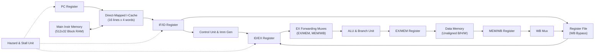
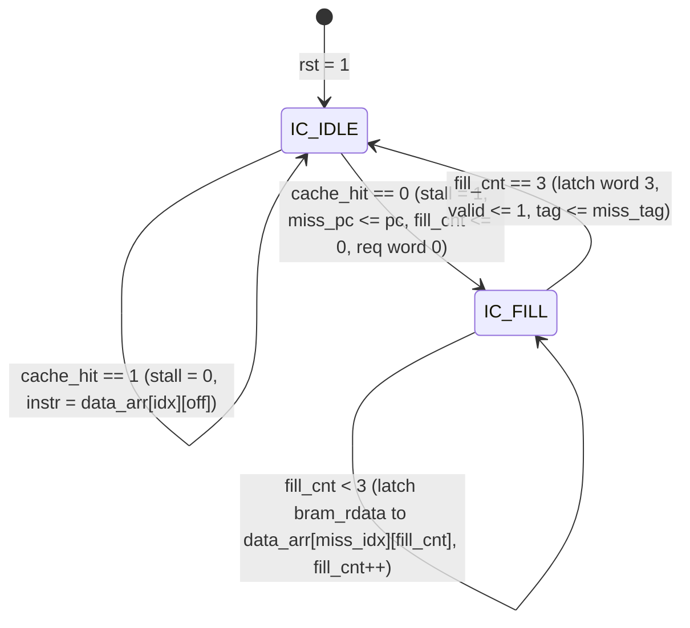

# E3: 245 Processor System Design — Laboratory Exercise 3
**DESE, Indian Institute of Science, Bangalore**  
**Name:** Anirudh  
**Target Device:** Digilent Basys 3 FPGA (`XC7A35T-1CPG236C`, Artix-7, Speed Grade `-1`)  
**Objective:** 5-Stage Pipelined 32-bit RISC-V Processor (RV32I) with Direct-Mapped Instruction Cache

---

## 1. Architecture Overview

The processor implements a 5-stage pipelined **RV32I** user-mode RISC-V architecture (**IF, ID, EX, MEM, WB**) with:
- **Direct-Mapped Instruction Cache (`icache.v`):** 16 cache lines × 4 words/block (64 words = 256 bytes total), backed by a synchronous **Block RAM** main instruction memory (`instr_bram.v`, 512 × 32-bit). On a miss, the cache controller stalls the pipeline and sequentially fills all 4 words of the block from BRAM without requiring burst transfers.
- **Data Forwarding (`forwarding_unit.v` & `reg_file.v`):** Full forwarding from **EX/MEM** (`fwd_a/b = 2'b10`), **MEM/WB** (`fwd_a/b = 2'b01`), and **WB-to-ID** register file write-through bypass.
- **Hazard Detection & Stall Unit (`hazard_unit.v`):**
  - **Load-Use Hazard:** Detects `id_ex_mem_read` targeting `if_id_rs1` or `if_id_rs2`, stalling `PC` and `IF/ID` for 1 cycle and inserting a NOP bubble into `ID/EX`.
  - **Control Hazard (Branch/Jump):** Resolves `BEQ/BNE/BLT/BGE/BLTU/BGEU`, `JAL`, and `JALR` in the EX stage; on redirect, flushes `IF/ID` and `ID/EX` and updates `PC` to the target address.
  - **I-Cache Miss Stall:** Freezes `PC` and all pipeline registers (`IF/ID`, `ID/EX`, `EX/MEM`, `MEM/WB`) until the 4-word block fill completes.
- **Unaligned Data Memory (`data_mem.v`):** 2048-byte byte-addressable memory supporting unaligned `LB`, `LBU`, `LH`, `LHU`, `LW`, `SB`, `SH`, and `SW`.

---

## 2. Datapath Block Schematic

### Instruction Cache Address Breakdown (32-bit Byte Address)
| Bits `[31:8]` (24 bits) | Bits `[7:4]` (4 bits) | Bits `[3:2]` (2 bits) | Bits `[1:0]` (2 bits) |
|---|---|---|---|
| **Tag** | **Cache Index (0..15)** | **Word Offset (0..3)** | **Byte Offset (`00`)** |

---

## 3. Controller & I-Cache FSM State Diagram

### Hazard & Forwarding Control Truth Table
| Condition | `stall_if/id` | `stall_ex/mem/wb` | `flush_if_id` | `flush_id_ex` |
|---|---|---|---|---|
| `icache_stall == 1` | `1` | `1` | `0` | `0` |
| `ex_redirect == 1` (Branch/JAL/JALR) | `0` | `0` | `1` | `1` |
| `load_use_stall == 1` | `1` | `0` | `0` | `1` |
| Normal execution | `0` | `0` | `0` | `0` |

---

## 4. Test Program: 16-bit Unsigned Restoring Division (Function Call + Unaligned Access)

- **C Reference:** `memory/restoring_div.c` (`restoring_divide(100, 7, &rem)`)
- **RISC-V Assembly:** `memory/restoring_div.asm` (uses `jal ra, restoring_divide` and `ret`/`jalr x0, ra, 0`)
- **Expected Outputs:**
  - `MEM[0x200]` (Quotient) = `14` (`0x0000000E`)
  - `MEM[0x204]` (Remainder) = `2` (`0x00000002`)
  - Unaligned `sb`/`lbu` at `0x209` (`0x5A`), `sh`/`lhu` at `0x20A` (`0xC0DE`), `lw` at `0x209` + load-use `addi` + `sw` at `0x210` (`0x00C0DE5B`).

---

## 5. Verification & Vivado Implementation Results

### 5.1 Behavioral Simulation (`iverilog` / `vvp`)
- **Quotient (`MEM[0x200]`):** `14` (`0x0000000e`) — PASS
- **Remainder (`MEM[0x204]`):** `2` (`0x00000002`) — PASS
- **Unaligned `MEM[0x208]`:** `0xc0de5a00` — PASS
- **Unaligned `MEM[0x210]` (Load-Use Hazard):** `0x00c0de5b` — PASS
- **Observed Pipeline & Cache Events:**
  - I-Cache Misses: `10` (50 total stall cycles; 5 cycles per 4-word BRAM fill)
  - Load-Use Stalls: `1`
  - Branch/Jump Flushes: `106`
  - EX/MEM/WB Forwarding Events: `73`

### 5.2 Vivado 2026.1 Post-Route Timing, Utilization & Timing Simulation
- **Target Device:** `xc7a35tcpg236-1` (Digilent Basys 3)
- **Resource Utilization (`reports/post_route_util.rpt`):**
  - **Slice LUTs:** `2955 / 20800` (`14.21%`) — `2699` LUT as Logic (`12.98%`), `256` LUT as Distributed RAM (`2.67%`, 4 × 512×8-bit `data_mem` banks)
  - **Slice Registers (FFs):** `4165 / 41600` (`10.01%`), `0` Latches
  - **Block RAM Tile:** `0.5 / 50` (`1 × RAMB18E1`, `1.00%`) for `instr_bram`
  - **DSPs:** `0 / 90` (`0.00%`)
- **Post-Route Timing Analysis (`reports/post_route_timing.rpt` @ 100 MHz / 10.000 ns constraint):**
  - **WNS:** `-0.596 ns` (Minimum Clock Period = `10.596 ns`, **$F_{\max} \approx 94.37\text{ MHz}$**)
  - **WHS:** `+0.128 ns` (`0` hold failing endpoints)
  - **WPWS:** `+3.750 ns` (`0` pulse-width failing endpoints)
- **Post-Implementation Timing Simulation (`basys3_top_tb_time_impl` via `xsim`):**
  - `sw = 2'b00` (Quotient): `led = 0x000e` (`14`) — **PASS**
  - `sw = 2'b01` (Remainder): `led = 0x0002` (`2`) — **PASS**
- **Bitstream:** `bitstream/basys3_top.bit` generated cleanly.
